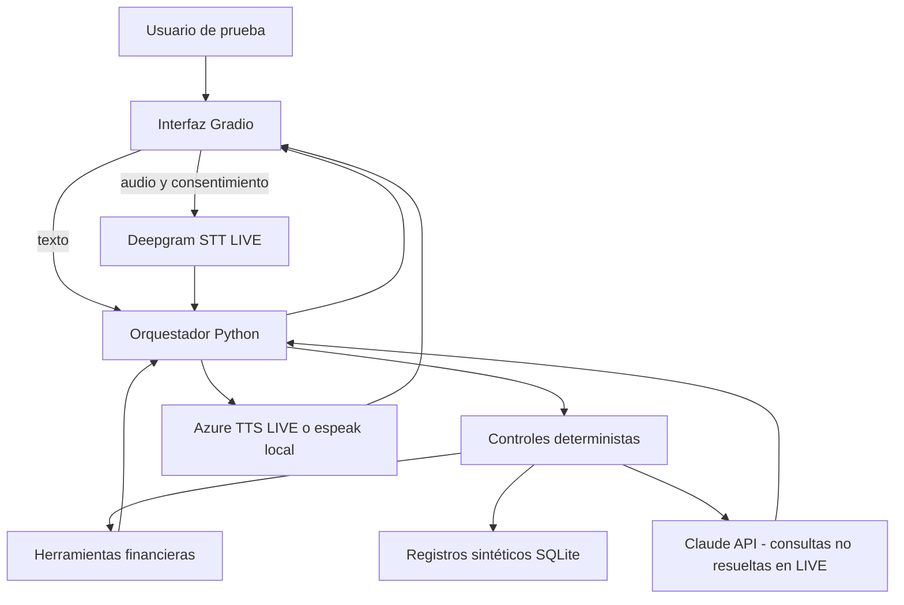

# Arquitectura y decisiones técnicas

**Alcance implementado:** Gradio -> orquestador Python -> motor de reglas/herramientas y SQLite sintético. En LIVE existe ruta hacia Claude (preguntas generales), Deepgram (voz entrante) y Azure Speech (voz saliente), sin verificación externa aún.

**Precedencia:** la detección de información privada, oposición a grabación, fraude, quejas, solicitud de humano y aprobación crediticia se ejecuta antes de invocar el modelo. Tasas y cuotas son plantillas construidas con resultados deterministas, no números generados por LLM.

**Límites claros:** sin PSTN/Twilio, sin llamada saliente real, sin transferencia real, sin identidad real, sin CRM, sin datos bancarios reales. La arquitectura no es simultánea ni admite interrupciones en flujo de voz: opera por turnos. En modo LIVE el SDK debe validarse con credenciales y la compatibilidad del proveedor.

**Riesgos operativos:** audio ingresado a Gradio pasa por cache temporal; no se retiene por elección de la base de datos, pero su ciclo de vida lo controla el servidor/hosting. API keys exclusivamente en variables de entorno y gestores de secretos. No registrar texto crudo en logs. El sistema NO cuenta con controles empresariales de autorización ni auditoría certificada.

**Finanzas:** función de cuota fija PMT = P × r / (1 − (1+r)^(-n)), r = tasa anual nominal/12. Se usa Decimal y redondeo de resultado final. No se añaden primas/comisiones ni se afirma representar un banco real.
