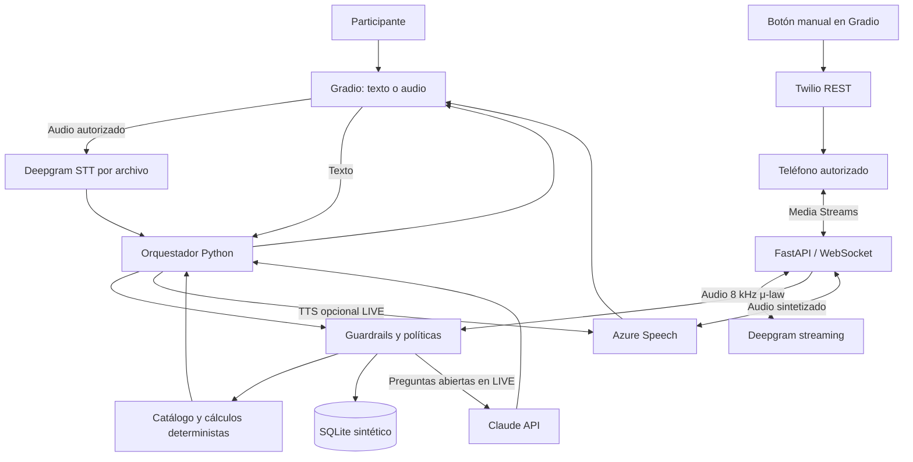

# Arquitectura y decisiones técnicas

El diseño es un MVP de **atención bancaria ficticia**; separa la lógica del agente, las herramientas deterministas, el
procesamiento de voz y el transporte telefónico. La interfaz Gradio opera por turnos; el piloto de Twilio usa audio por
WebSocket. Ambas modalidades requieren pruebas LIVE independientes.

## Módulos

| Archivo                   | Responsabilidad                                                                   |
|---------------------------|-----------------------------------------------------------------------------------|
| `app.py`                  | Interfaz, chat, consentimiento de audio, simulación y llamada manual restringida. |
| `src/agent.py`            | Reglas, decisiones y uso de Claude cuando corresponda.                            |
| `src/tools.py`            | Consulta del catálogo, cuotas y políticas deterministas.                          |
| `src/speech.py`           | Audio grabado hacia Deepgram y síntesis Azure por archivo.                        |
| `src/telephony.py`        | Validación RD E.164, DNC, allowlist, límites y solicitud Twilio REST.             |
| `src/telephony_server.py` | Webhook de estado, WebSocket, streaming y síntesis telefónica.                    |
| `src/storage.py`          | Registros SQLite del prototipo.                                                   |
| `data/`                   | Información de prueba y escenarios sintéticos.                                    |

## Flujos de llamada

- **Gradio:** se recibe audio de prueba, se solicita consentimiento, Deepgram devuelve texto; el motor responde mediante
  reglas/herramientas y, cuando aplica, Claude; Azure puede sintetizar una respuesta en WAV.
- **Twilio:** una persona operadora inicia explícitamente una única llamada de prueba a un número previamente
  autorizado. Twilio crea la llamada y solicita el TwiML/stream indicado. FastAPI recibe el audio μ-law 8 kHz, lo remite
  a Deepgram streaming, invoca el motor y devuelve audio de Azure adaptado al formato telefónico. Existe un mensaje
  inicial de identificación de IA. La conversación es **por turnos** y no admite interrupciones simultáneas
  garantizadas.

## Diseño financiero y seguridad

Las tasas salen del catálogo ficticio; la cuota sigue la fórmula de amortización `PMT = P·r/(1−(1+r)^(-n))`, con `r`
mensual y `n` meses. No supone seguros, impuestos ni comisiones y no constituye una oferta de crédito. El agente no
aprueba ni rechaza préstamos ni consulta cuentas bancarias reales.

Las restricciones telefónicas incorporan confirmación de consentimiento, lista permitida de `+1809/+1829/+1849`,
exclusión DNC, horario, límite diario y máximo de una llamada simultánea. Son salvaguardas parciales, **no equivalen a
cumplimiento normativo ni a autenticación de un servicio productivo**.

## Operación y limitaciones

La aplicación se ejecuta con uv o en Docker Compose (`vantra` en 7860 y `twilio-webhook` en 8000) y un volumen SQLite
compartido. La puerta pública de ngrok debe dirigirse **solo a FastAPI**, no al panel Gradio. Las credenciales se
configuran por entorno. No se debe exponer Gradio públicamente sin autenticación y control de costos.

No existen integraciones con CRM bancario real, autorizaciones de identidad real, transferencia humana efectiva ni
marcación por lotes. El código de los conectores **no demuestra por sí solo** llamadas ni latencias observadas; esas
métricas deben registrarse por separado.

Véanse [instalación](installation.md), [telefonía](telephony.md) y [evaluación](evaluation.md).
